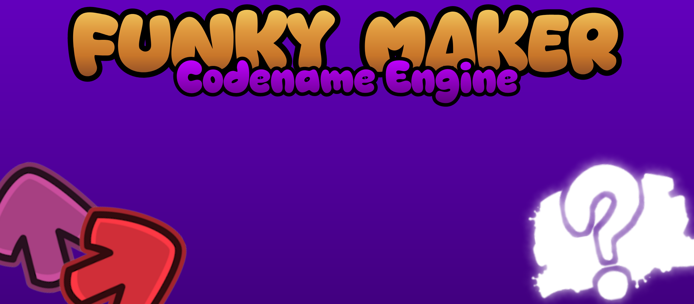

  

<table>
  <tr>
    <td width="200">
      
        
icon in android 32 xd

    </td>
    <td>
      <h3>Funky Maker: Codename Engine</h3>
      
A HaxeFlixel/OpenFL rhythm-game engine inspired by Funky Maker: Mobile.

      

        <a href="building/README.md">Building guide</a>
        ·
        <a href="LICENSE">License</a>
      

    </td>
  </tr>
</table>
Requirements

- Haxe 4.3.7
- HaxeFlixel and OpenFL dependencies
- A supported Lime build toolchain
- other dependencies is descrited in /building/libs.txt

Quick start

haxelib run lime test linux

Replace "linux" with your target platform when needed.

Project layout

- "source/": Engine source code
- "assets/": Game assets and resources [materal del fnf tambien aqui, que miedo wei]
- "Project.xml": Project configuration

Credits

check Credits in the game.

See ""LICENSE"" (LICENSE) for licensing information.

<footer>JarretLabs 2026</footer>
